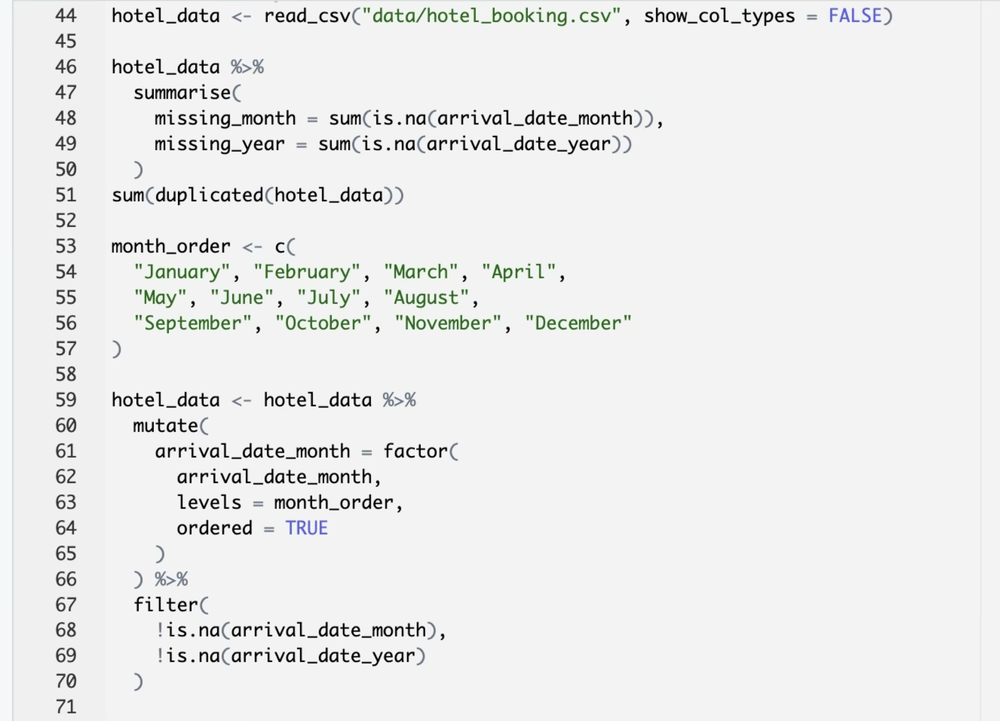
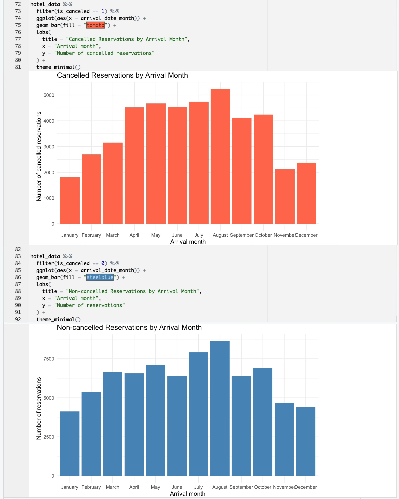
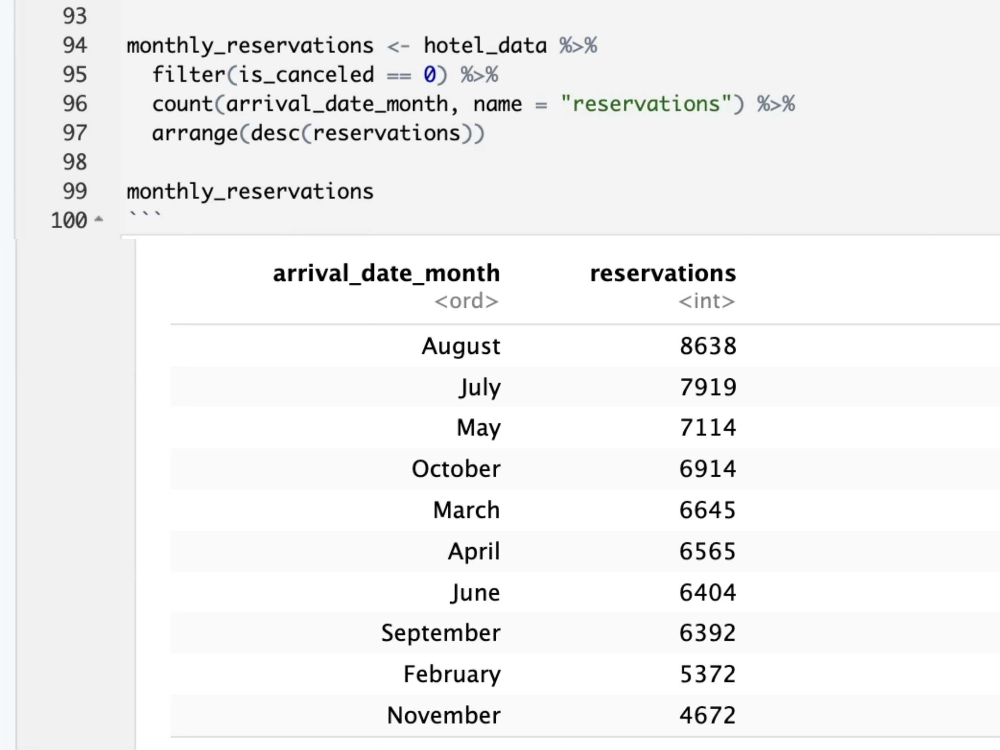
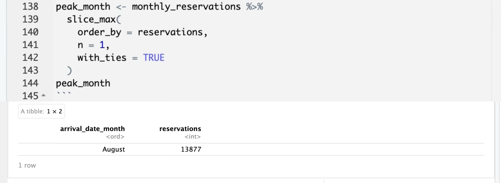

```{r install-package, include = FALSE, eval = FALSE}
# Copy and paste the following code into your console to download and install
# the `xaringan` package that contains all of the code which allows you 
# to create presentation slides in Rmarkdown
install.packages('xaringan')
```


```{r load-packages, include = FALSE}
# Add any additional packages you need to this chunk
library(tidyverse)
library(tidymodels)
library(palmerpenguins)
library(knitr)
library(xaringanthemer)
```

```{r setup, include=FALSE}
# For better figure resolution
knitr::opts_chunk$set(fig.retina = 3, dpi = 300, fig.width = 6, fig.asp = 0.618, out.width = "80%")
```

```{r load-data, include=FALSE}
# Load your data here

```

```{r include=FALSE}

#Background image
style_xaringan(
  title_slide_background_image = "img/background.jpg"
)
```

class: center, middle

# Contents

## 01 Background

## 02 Research Analysis and Findings

## 03 Conclusion

---

class: inverse, center, middle

# Background


The hotel industry faces changing booking demand due to differences in travel seasons, room prices and customer preferences.

Understanding hotel booking patterns is important for effective business planning, including room allocation, pricing strategies and resource management.

In this project, we use the Hotel Booking Demand dataset to explore the factors associated with hotel booking demand, comparing City Hotels and Resort Hotels from different perspectives.

---

# Part 1: Monthly Booking Trends

.pull-left[

]

.pull-right[

]

---

# Part 1: Monthly Booking Trends

.pull-left[

]

.pull-right[

]

---

# Part 2: Room Prices


---

# Part 3: Customer Groups


---

# Part 4: Parking Requirements


---

class: center, middle
background-image: url("img/bc.png")
background-size: cover
background-position: center

# <span style="color:#FFFFFF;">Conclusion</span>

<span style=";color:#FFFFFF;">
This project explored hotel booking demand from four different perspectives: monthly booking trends, room prices, customer groups and parking requirements.

<span style=";color:#FFFFFF;">
The analysis highlights differences in booking patterns and customer needs between City Hotels and Resort Hotels. It also shows that hotel demand and resource requirements can vary across different months and years.

<span style=";color:#FFFFFF;">
In particular, Resort Hotels had considerably higher parking requirements than City Hotels, with approximately 4,750 spaces compared with 1,950.

<span style=";color:#FFFFFF;">
Overall, understanding these patterns can help hotels make better decisions about pricing, room allocation and resource planning.

---

class: center, middle
background-image: url("img/th.jpg")
background-size: cover
background-position: center

# <span style="color:#FFFFFF;">Thank You for Listening!</span>
